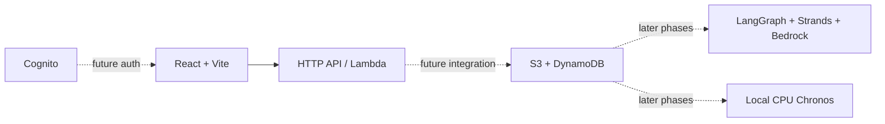

# ENERGY TRUTH

An outside-in energy and emissions audit for Indian companies, comparing public disclosures with plant ownership, inventories and grid evidence. This initial increment is the local P0 foundation; source ingestion and audit execution are not implemented.

## Run locally
Node 22.12+ and Python 3.12+ are required.

```sh
make install
cp .env.example .env
make api
# In another terminal
make dev
```

Open http://127.0.0.1:5173. The company selector calls the local API through Vite. Scorecards show evidence pending until real ingestion exists. Use `make test` for contracts, type checks and frontend build; `make synth` for CloudFormation generation without deployment.

## AWS foundation
CDK defines three private retained S3 buckets, eight on-demand retained DynamoDB tables, Cognito, an HTTP API and a Python Lambda. It creates no SageMaker endpoint, OpenSearch collection, VPC/NAT or Fargate service. Public API routes expose readiness only. Real estimate/auth integration follows in later phases.

Complete AGENTS.md Step 1. Export your .env in your shell before `make preflight` or `make deploy`. Check budget and Bedrock invocation separately; the preflight checks identity only. Deploy writes outputs to work/cdk-outputs.json; outputs are not yet automatically mapped into .env. Amplify repo connection and first production publication require the documented review. Set VITE_API_BASE_URL to the deployed API and configure exact-origin CORS before connecting a cross-origin frontend. amplify.yml supplies the monorepo build specification.

`make cost-check` reads regional endpoint/collection/cluster/NAT lists and tagged month-to-date costs. This is an initial inspection, not proof of zero idle spend across all regions; ECS task inspection remains manual. `make teardown` intentionally refuses deletion until approved.

## Architecture


Read PROGRESS.md, DECISIONS.md and BLOCKERS.md for actual implementation status. docs/MAP_DESIGN.md describes the proposed factory map; no map is implemented.

## Attribution
Planned source integrations: Climate TRACE, Global Energy Monitor, Robbie Andrew / Grid-India electricity data, CEA, NASA EOSDIS/GIBS, Copernicus/Sentinel and company BRSR filings. Verify each source's license before caching or redistributing. No data from these sources is bundled yet.
