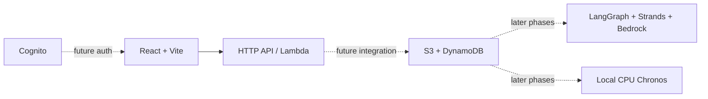

# ENERGY TRUTH

An interactive research workspace for reviewing company-linked emissions evidence. The demo works entirely in the browser with cached public Climate TRACE responses. AWS infrastructure remains a separate, undeployed foundation.

## Run the interactive demo

```sh
npm ci
npm run dev
```

Open http://localhost:5173. No Python server or cloud credentials are needed for this demo.

Try this journey:
1. Select NTPC or Tata Steel and a calendar year.
2. Search or filter facilities; select a map point or inventory row.
3. Open source evidence, inspect the original record, or download the snapshot.
4. Run the local evidence review and add findings to your brief.
5. Add notes, download the cited Markdown brief, or print/save as PDF.

Map controls support pan, zoom, fit, tilt and Esri satellite context. Company/year-specific notes, reviewed facilities and saved findings persist in localStorage. The command search opens with Ctrl/⌘ K. The guided tour explains the workflow. Keyboard users can operate map markers with Enter and use the full facility table.

## What is real, and what remains open

Real: Climate TRACE facility inventories (41 NTPC-linked and 20 Tata Steel-linked records per loaded year), three annual snapshots, source hashes, derived totals, local integrity checks and export. Full-facility sums are not ownership-weighted company Scope 1. The app clearly flags incomplete ownership/disclosure reconciliation. No live AI audit, forecast or company misreporting verdict is claimed.

Remote map tiles require internet. Cached Natural Earth boundaries and the facility table remain available if basemap requests fail. Browser state is local to this device, not a shared team backend.

See docs/DATA_ATTRIBUTION.md for methods and source terms.

## Validation

```sh
npm run build
npm run typecheck
node --import tsx tests/review.test.ts
python3 -m unittest discover -s tests -v
```

To refresh source snapshots deliberately: `python3 scripts/fetch_demo_snapshot.py`, then `python3 scripts/build_demo_snapshot.py`. Source values may change; inspect the diff before publishing. The public demo bundle is committed and requires no re-fetch to run.

The initial Python API can still be run separately with `make install` and `make api`; it retains the P0 readiness contract and is not the demo data backend.

## AWS foundation
CDK defines three private retained S3 buckets, eight on-demand retained DynamoDB tables, Cognito, an HTTP API and a Python Lambda. It creates no SageMaker endpoint, OpenSearch collection, VPC/NAT or Fargate service. Public API routes expose readiness only. Real estimate/auth integration follows in later phases.

Complete AGENTS.md Step 1. Export your .env in your shell before `make preflight` or `make deploy`. Check budget and Bedrock invocation separately; the preflight checks identity only. Deploy writes outputs to work/cdk-outputs.json; outputs are not yet automatically mapped into .env. Amplify repo connection and first production publication require the documented review. Set VITE_API_BASE_URL to the deployed API and configure exact-origin CORS before connecting a cross-origin frontend. amplify.yml supplies the monorepo build specification.

`make cost-check` reads regional endpoint/collection/cluster/NAT lists and tagged month-to-date costs. This is an initial inspection, not proof of zero idle spend across all regions; ECS task inspection remains manual. `make teardown` intentionally refuses deletion until approved.

## Architecture


Read PROGRESS.md, DECISIONS.md and BLOCKERS.md for actual implementation status. docs/MAP_DESIGN.md describes the proposed factory map; the map has now been implemented under the user-authorized demo rebuild.

## Attribution
Planned source integrations: Climate TRACE, Global Energy Monitor, Robbie Andrew / Grid-India electricity data, CEA, NASA EOSDIS/GIBS, Copernicus/Sentinel and company BRSR filings. Verify each source's license before caching or redistributing. No data from these sources is bundled yet.
