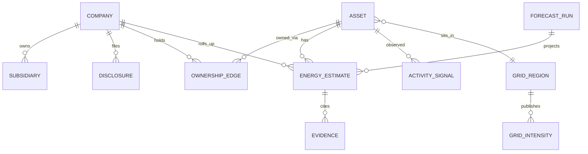
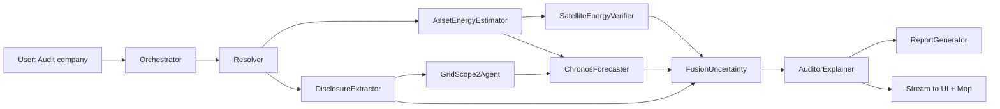
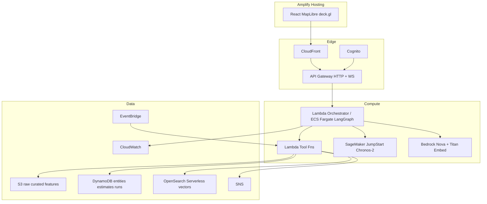

# ENERGY TRUTH — Energy & Emissions Intelligence Platform

**Hackathon:** WeMakeDevs × AWS Environmental Hacks · Track: **Waste and Energy** (framed as **Energy**)  
**Product name (working):** ENERGY TRUTH  
**USP:** The carbon footprint **of energy** — company-level energy use & generation reconciled against independent plant/grid/satellite evidence, fused with uncertainty, with a live agent audit trail.  
**Companion docs:** `/workspace/UNIFIED_COMPANY_CARBON_MODEL.md`, `/workspace/carbon_coverage.csv`  
**Data probes:** `/workspace/carbon_data/plan_probe/` (POSOCO, CEA DGR, India monthly, GIBS caps)  
**Verification date:** 2026-10-09 IST

---

## Layman summary (read this first)

1. Big Indian companies must publish how much energy they burn and how much CO₂ that creates (BRSR). Those numbers are hard to check.
2. Satellites, plant databases, and India’s grid operator already publish independent clues about the same energy: which power plants run, how dirty the grid is this month, NO₂ over stacks, flares at oil sites.
3. ENERGY TRUTH pulls all of that into one company map: every plant a company owns, how much energy-related CO₂ it likely emits, vs what the company reported.
4. Where the two disagree, you see a score plus the evidence (filing page, plant, grid factor, satellite tile) — not a black-box “trust us” number.
5. Chronos-2 (Amazon’s time-series model on SageMaker) forecasts next months’ plant/grid emissions using real fuel-mix and generation covariates, and turns those forecasts into uncertainty bands.
6. You talk to an agent (“Audit Tata Steel’s energy carbon”). It streams each step live: resolve company → read BRSR → sum plants → check grid → check satellite → forecast → fuse → explain.
7. The map is the home screen: plants sized by energy emissions, colored by reported-vs-independent gap, with live NO₂ / night-lights / thermal layers as energy-activity proxies.
8. Built on AWS (Bedrock Nova/Titan, SageMaker Chronos-2, S3, Lambda, Amplify) with a LangGraph multi-agent backend; Strands can wrap one judge-facing agent for hackathon OSS points.
9. Who uses it: ESG/energy analysts, lenders, journalists, SEBI-curious researchers — anyone who needs energy-carbon truth, not another meter dashboard.
10. This is not an IIoT meter product and not an air-quality app: every pixel and model exists to verify **energy generation, consumption, and the carbon of that energy**.

---

## 1. Problem & product thesis

### 1.1 Precise problem (energy framing)

Indian listed firms disclose **energy consumption** and **GHG from energy** (BRSR Principle 6: Scope 1 fuel combustion, Scope 2 purchased electricity). Policy and capital markets treat those disclosures as ground truth. Independent energy-system data (Climate TRACE plant inventories, GEM plant ownership/capacity, CEA grid emission factors, Grid-India/POSOCO fuel mix, satellite combustion proxies) often disagree — or cannot even be joined because entities, units, and fiscal years do not align.

**Open capability:** a live **energy-carbon MRV layer** that:

- rebuilds each company’s **energy-related** Scope 1 (owned combustion assets) and Scope 2 (purchased MWh × grid EF) from public energy data;
- compares to BRSR energy/GHG tables;
- fuses both with explicit uncertainty;
- nowcasts/forecasts with Chronos-2 using energy covariates;
- leaves an evidence trail a human can audit.

Scope 3 is in-scope only where it is **energy-chain** (purchased fuels, upstream electricity in supply chain via EEIO on energy-related spend) — not a general product LCA toy.

### 1.2 Why this wins Waste and Energy

Hackathon track language: *“what we throw away, and how we power what we keep”* / rooftop solar, EV, power. ENERGY TRUTH attacks **how we power industry** — the largest controllable energy-carbon stock in India (coal plants, steel/cement process energy, captive power). Carbon is the **scoreboard for energy**, not a separate theme.

### 1.3 Judging criteria (quoted from https://wemakedevs.org/aws/env)

| Criterion | How ENERGY TRUTH maps |
|---|---|
| **01 Idea and Impact** — “Does it fix a real environmental problem? … A small problem solved well beats a big one solved vaguely.” | Hybrid verification of **corporate energy GHG** (documented gaps: Lepere 2025; Kania 2026; NCC 2025 revisions). Live India companies, not a toy city. |
| **02 Built on AWS** — “Using an AWS open-source project or AWS services is mandatory to win a prize.” | Ship It: Amplify, API Gateway, Lambda, S3, DynamoDB, Bedrock, SageMaker JumpStart Chronos-2, EventBridge, SNS, Cognito, CloudWatch. Build It OSS: **LangGraph** + optional **Strands Agents SDK** agent, Chronos, CaML. |
| **03 Design and usability** — clear for someone not on the team | Map-first UI + “Audit” chat with streamed agent steps and citations. |
| **04 The execution** — “Does it work? … One feature that runs beats five that almost do.” | Every claimed path runs on real data; phased build order ensures the core spine works before surfaces. | No simulated tonnes; every number from BRSR PDF / CT / GEM / POSOCO / CEA / GIBS. |
| **05 The demo video** — 3 minutes, recorded; **no live demo** | Scripted 90s wow + full 3‑min: problem → map → agent audit → Chronos band → AWS stack slide. |

Also: “You can build with AWS open source tools, AWS cloud services, or both.” Free tier up to **$200** credits; top track prize ₹2L + $2k AWS credits.

### 1.4 Scientific anchors (energy-carbon verification only)

- Lepere et al. 2025 — firm under-reporting vs Climate TRACE (energy sector elevated). https://www.kcl.ac.uk/business/assets/PDF/research-papers/lepere-emissions-dissonance-sele2025.pdf  
- Kania, JUMS 2026 — GHGRP vs CT; hybrid bottom-up/top-down. https://doi.org/10.5282/jums/v11i3pp561-597  
- Nature Climate Change 2025 — widespread self-report revisions. https://www.nature.com/articles/s41558-025-02494-9  
- Gurney et al. ERL 2024 — CT powerplant method bias → **confidence weighting required**. https://iopscience.iop.org/article/10.1088/1748-9326/ad8364  

Live India hooks (verified 2026-10-08/09): Tata Steel consol. BRSR S1 **78 Mt** vs CT owner-sum ~**30 Mt** (incomplete ownership vs GEM 109 assets); NTPC S1 **327 Mt** vs CT ~**368 Mt**.

---

## 2. Competitive UX: The Sustainability Cloud Energy → what we take / beat / skip

Source: https://www.thesustainabilitycloud.com/products/energy/ (fetched 2026-10-09). TSC is an **IIoT meter → Scope 2 compliance** product. We are an **external energy-carbon truth** product. Do not copy branding.

| TSC feature | Pattern | Our stance |
|---|---|---|
| Precise energy monitoring (inflow/outflow, asset diagrams) | Facility dashboard | **Replicate pattern** as **asset energy inventory** from public capacity × activity — not Modbus meters |
| Energy budgeting / targeting | Planning UX | **Skip** (needs private meter baselines) |
| Anomaly detection & alerts | Timeseries alerts | **Beat**: Chronos predictive bands + BRSR-vs-independent z-scores + EventBridge on new filings/plumes |
| Secure meter→cloud acquisition | IIoT | **Skip** (no custom hardware; out of theme for public MRV) |
| REC / offset tracking | Compliance | **Demote / skip** for core (optional footnote) |
| Automated Scope 2 accounting | EF × MWh | **Beat**: CEA EF version-pinned + live POSOCO/Ember intensity nowcast + Chronos intensity forecast |
| SCADA/Modbus real-time | Hardware | **Skip** |
| EDI regulator reporting | Enterprise | **Skip**; instead **auto BRSR-style energy-carbon audit PDF** from public evidence |
| Charts of energy by source | Breakdown UI | **Replicate**: fuel-mix and Scope 1/2 energy-carbon stacked charts |

**UX patterns we adopt:** asset-level map+table, source-type breakup, alert inbox, report export.  
**UX patterns we invent:** reported vs independent split view, coverage ratio, agent run timeline, satellite energy-proxy layers, probabilistic forecast ribbon.

---

## 3. Personas & user loops

| Persona | Job | Loop |
|---|---|---|
| **ESG / energy analyst** (NBFC, AMCs, Big4 climate) | Validate BRSR energy & GHG before lending/rating | Search company → map plants → open discrepancy → export audit PDF |
| **Corporate energy / sustainability lead** | Stress-test own disclosure before filing | Upload/link BRSR → see independent rebuild → fix gaps |
| **Energy journalist / researcher** | Story on under/over reporting | Agent chat “who diverges most in power?” → cite plants |
| **Hackathon judge** | Understand in 3 minutes | Landing → one-click “Audit NTPC” → wow |

Primary loop: **Select company → Energy Carbon Scorecard → Asset map → Evidence drawer → Agent Q&A → Export**.

---

## 4. Core screens & features (complete product)

1. **Company Energy Carbon Scorecard** — Reported vs Independent vs Fused (±σ) for energy-related S1/S2; coverage ratio; Chronos next-6-month band.  
2. **Asset Energy Map** (home) — plants as points; size = energy-related emissions; color = gap; halo = ownership coverage; region choropleth = grid carbon intensity.  
3. **Plant Energy Detail** — capacity (GEM), CT activity/emissions, confidence, fuel type, monthly energy series, Chronos forecast, satellite strip (NO₂, night lights, thermal).  
4. **Grid Intensity Desk** — POSOCO/CEA fuel mix → implied tCO₂/MWh path; Chronos intensity forecast; drives Scope 2.  
5. **Agent Audit Console** — chat + **live LangGraph node timeline** + tool I/O + map highlights as nodes finish.  
6. **Evidence Drawer** — PDF quote, CT id, GEM wiki, GIBS timestamped tile, CEA EF version.  
7. **What-if Energy Switch** — shift purchased power to lower-intensity months / higher RE share (Chronos future covariates) → Δ Scope 2.  
8. **Alerts Inbox** — new BRSR filing detected, CT asset update, thermal anomaly near owned plant, intensity spike.  
9. **Report Studio** — one-click BRSR-style **Energy & GHG Audit** PDF (Nova-written, citation-locked).  
10. **Data Provenance / Methodology** — versions, licenses, FY vs calendar alignment rules (judge trust).

---

## 5. Data unification (hunt → canonical energy graph)

### 5.1 Source catalog (verified where marked)

| Source | Gives (energy lens) | Grain | Cadence | Access | Verified live? | License / note |
|---|---|---|---|---|---|---|
| **Company BRSR PDF** | Energy consumption tables; Scope 1/2/3 GHG; assurance | Company | Annual (FY) | IR sites / NSE archives | **Yes** Tata, NTPC PDFs | Public disclosure |
| **NSE BRSR UI** | Filing index; CSV/XBRL convert | Company | Annual | Browser UI | Page **yes**; JSON API **no** | Exchange |
| **Dataful BRSR_P6** | Structured S1/S2/S3 | Company | Annual | Commercial API/UI | Preview **yes** | Paid |
| **Climate TRACE API v7** | Asset energy activity + GHG; owners; confidence | Plant | Annual in API responses tested; CSV packs may hold richer | `api.climatetrace.org/v7` | **Yes** owners/sources | Attribute CT; research use |
| **CT downloads** | Geometries GeoPackage; sector packs | Plant | Release trains | `downloads.climatetrace.org` | **HEAD 200** on geometries zip | Attribute CT |
| **GEM Ownership API** | Plants, MW, owners, status; IDs shared with CT | Unit/plant | Tracker releases | `api.globalenergymonitor.org` | **Yes** | Attribution; check tracker ToU |
| **CEA CO₂ Baseline** | Grid EF tCO₂/MWh | National grid | Annual FY | cea.nic.in (login wall); V20 PDF mirror | **V20 yes** (0.727 FY23-24); V21/22 **unverified files** | GoI |
| **Robbie Andrew POSOCO CSV** | Daily regional/national fuel mix & demand | Region/India | Daily | `robbieandrew.github.io/india/data/POSOCO_data.csv` | **Yes** 2013-01-02→2026-10-06 | Cite Andrew; derived from Grid-India reports |
| **Robbie Andrew CEA DGR** | Daily generation by fuel | National | Daily | `CEA_DGR_data.csv` | **Yes** | Cite Andrew |
| **Robbie Andrew India monthly** | Coal/power/cement/steel activity series | National | Monthly | `India_monthly_data.csv` | **Yes** 1998-04→2026-09, 211 series | Cite Andrew / ESSD 2020 |
| **Grid-India report portal** | Official daily PSP PDFs | National | Daily | report.grid-india.in | TLS fail this session | GoI |
| **Ember India / monthly electricity** | Gen, capacity, power-sector emissions, intensity | State/national | Monthly | ember-energy.org | Site **Cloudflare 403** from this host; CC-BY-4.0 claimed on Ember pages | Prefer browser download or Robbie proxies |
| **Electricity Maps** | Zone carbon intensity | Zone | Near-real-time | API key | Redirect; treat as **optional paid** | Skip unless key |
| **NASA GIBS WMTS** | TROPOMI NO₂, VIIRS DNB night lights, VIIRS thermal anomalies, true color | Pixel/tile | Daily | **No key** | **Yes** NO₂ & DNB PNG 200; TROPOMI layer default 2026-10-08 | NASA EOSDIS |
| **NASA FIRMS** | Active fire/flare detections | Point | NRT | WMS caps **yes**; CSV API needs **MAP_KEY** | Partial | Free key from FIRMS |
| **Sentinel-5P AWS Open Data** | NO₂/CH4 L2 orbits | Pixel | Daily | `s3://meeo-s5p` no-sign | **Yes** list 2026 prefixes | Copernicus notice |
| **Sentinel-2 L2A COGs** | True-color plant imagery | 10 m | ~5-day | Element84 earth-search STAC **no key** | **Yes** Jamshedpur scene 2026-10-08 | Open |
| **Carbon Mapper** | CH₄/CO₂ plumes (O&G, etc.) | Plume | Campaign/NRT | Registration | Portal yes; API needs account | Non-commercial free |
| **IMEO MARS** | Methane events (energy infrastructure) | Event | NRT | Web | TLS flaky | UNEP |
| **OpenStreetMap / Overpass** | Plant footprints, power tags | Polygon/node | Continual | Overpass | Flaky this session; keep as enricher | ODbL |
| **MCA CIN** | Legal identity crosswalk | Company | — | mca.gov.in | **403** this host | Use CIN from BRSR/Dataful |
| **Amazon CaML + USEEIO** | Map energy-related spend → EEIO factors | Sector | Static+ | GitHub Apache-2.0 | Repo **yes** (pushed 2026-10-06) | Apache-2.0 |
| **CDP full GHG** | Extra disclosure | Company | Annual | Licensed | Portal exists | **Do not depend** |

**Demoted / out of energy theme:** landfill waste methane storytelling, AQI/health dashboards, water stress — do not ship.

### 5.2 Canonical entity graph



**ID crosswalk**

| ID | System |
|---|---|
| `cin` | MCA / BRSR |
| `nse_symbol` / `isin` | Exchange |
| `ct_owner_id` / `ct_source_id` | Climate TRACE (= GEM entity style `E…` / numeric source) |
| `gem_asset_id` / `gem_entity_id` | GEM |
| `osm_id` | OSM |
| `gadm_id` / grid region code | Spatial join to POSOCO NR/WR/SR/ER/NER |

### 5.3 Entity resolution

1. Exact: CT owner id ↔ GEM entity id (verified identical for Tata/NTPC/UltraTech…).  
2. Soft: Titan Embeddings v2 on `(legal_name, alias, plant_name, state)` → FAISS/OpenSearch kNN; threshold + human-in-loop on low score.  
3. Spatial: CT centroid ↔ GEM lat/lon ↔ OSM within 2–5 km + same fuel/sector.  
4. Store `match_method`, `match_score`, `review_status` on `OWNERSHIP_EDGE` / `ASSET`.

### 5.4 Unit & calendar alignment

- Emit **tCO₂e** and **MWh** / **TJ** internally; never mix Mt/t silently.  
- BRSR = **Indian FY** (Apr–Mar); CT API totals observed as **calendar year** labels; POSOCO = **calendar day IST**.  
- Store `period_start`, `period_end`, `period_type`. Comparison UI always shows alignment rule.  
- Scope 2: `purchased_mWh_FY × CEA_EF_version` (location-based). Residual national intensity from POSOCO coal/gas share used only for **nowcast delta**, clearly labeled.

### 5.5 Energy-carbon estimators

**Scope 1 (energy / combustion assets):**

\[
E^{ind}_{c,S1}=\sum_{a\in\mathcal{A}_c} w_{a,c}\,E^{CT}_{a}
\]

with coverage ratio \(\rho= |\mathcal{A}^{CT}_c|/|\mathcal{A}^{GEM}_c|\). If \(\rho\) low, widen \(\sigma\) and flag.

**Scope 2 (purchased electricity):**

\[
E^{ind}_{c,S2}=MWh^{BRSR}_{purchased}\times EF^{CEA}_{FY}
\]

optional nowcast: scale EF by Chronos-predicted intensity index from fuel mix.

**Scope 3 (energy-chain only):** CaML/Parakeet map of fuel/electricity-related spend lines → USEEIO factors (optional module).

**Fusion:** inverse-variance on reported vs independent per scope; CT `confidence` ordinals → \(\sigma_{ind}\); assurance flag → \(\sigma_{rep}\). Discrepancy \(z=(E_{ind}-E_{rep})/\sqrt{\sigma_{ind}^2+\sigma_{rep}^2}\).

**Provenance:** every estimate row links `evidence_ids[]` (URL, PDF page hash, API payload hash, tile time).

---

## 6. Chronos-2 — core energy forecasting engine (not decorative)

### 6.1 Why Chronos-2 is load-bearing

Amazon Chronos-2 (JumpStart id `pytorch-forecasting-chronos-2`) natively supports **past + known-future covariates** and **quantile forecasts**. That is exactly the energy problem: emissions/activity follow **fuel mix, generation, seasonality** that we *do* observe daily/monthly from POSOCO/CEA/Robbie Andrew — while BRSR arrives once a year.

Docs: https://www.amazon.science/blog/introducing-chronos-2-from-univariate-to-universal-forecasting · SageMaker notebook: https://github.com/amazon-science/chronos-forecasting/blob/main/notebooks/deploy-chronos-to-amazon-sagemaker.ipynb

### 6.2 Concrete forecasting tasks

| ID | Target series | Past covariates | Known future covariates | Horizon | Feeds |
|---|---|---|---|---|---|
| **T1 Plant energy activity** | Monthly MWh or tCO₂e proxy per plant | Regional coal/gas/RE gen (POSOCO), national cement/steel/coal series (India_monthly), CT capacity factor if present | Calendar month, planned capacity (GEM), regional demand outlook from last-year seasonality | 6–12 months | Independent S1 nowcast; anomaly vs BRSR annualized |
| **T2 Company rollup** | Ownership-weighted sum of T1 | Same + company sector dummy | Same | 6–12 | Scorecard ribbon |
| **T3 Grid carbon intensity** | Monthly implied tCO₂/MWh from fuel mix × CEA-calibrated factors | POSOCO India coal/gas/RE shares, demand | Month-of-year; optional Ember intensity if obtained | 6–12 | Scope 2 nowcast/forecast |
| **T4 Multivariate plant cluster** | Joint forecast of top N plants in a company | Shared regional mix | Shared calendar | 6 | Captures co-movement (maintenance seasons) |

**Critical data honesty:** CT v7 `GET /sources/{id}` responses tested returned **annual** `emissions[]` points (not month). Therefore T1 targets are built as:

1. Prefer CT **download packs** / monthly fields when present in CSV;  
2. Else **energy activity proxy**: \( \tilde{E}_{a,m} = Cap_a \times CF^{region}_{fuel,m} \) calibrated so annual sum matches CT annual;  
3. Always expose method tag `target_construction=ct_monthly|calibrated_capacity_mix`.

POSOCO→monthly coal MWh covariates: **166 months** verified (201301→202610).

### 6.3 Payload shape (SageMaker real-time)

```json
{
  "inputs": [{
    "item_id": "ct:25451489",
    "start": "2015-01-01",
    "target": [/* >=30 monthly floats tCO2e or MWh */],
    "past_covariates": {
      "india_coal_gen_mu": [/* len=T */],
      "india_gas_gen_mu": [/* T */],
      "india_res_gen_mu": [/* T */],
      "region_demand_mu": [/* T */],
      "month_sin": [/* T */],
      "month_cos": [/* T */]
    },
    "future_covariates": {
      "india_coal_gen_mu": [/* H — from persistence or secondary forecast */],
      "india_gas_gen_mu": [/* H */],
      "india_res_gen_mu": [/* H */],
      "region_demand_mu": [/* H */],
      "month_sin": [/* H */],
      "month_cos": [/* H */]
    }
  }],
  "parameters": {
    "prediction_length": 6,
    "freq": "MS",
    "quantile_levels": [0.1, 0.5, 0.9],
    "batch_size": 64
  }
}
```

Response quantiles → \(\sigma\) for fusion: e.g. map \((q_{0.9}-q_{0.1})/2.56\) as Gaussian-ish scale for the nowcast component.

### 6.4 Deployment choice

| Mode | Use |
|---|---|
| **JumpStart real-time** `ml.g5.xlarge` or `ml.g5.2xlarge` | Interactive agent + UI (preferred) |
| **CPU** `ml.c5.2xlarge` / `ml.m5.2xlarge` | Quota fallback |
| **Serverless 6GB** | Cost save; cold start OK for batch audits |
| **Scale-to-zero** on real-time | Mandatory for $200 credits survival |
| **Local Chronos-2** in Lambda container / ECS | Dev & offline backtests |

**Default:** JumpStart real-time (`ml.g5.xlarge`) + scale-to-zero; delete/scale down when idle. Local Chronos-2 CPU proved fast enough for batch backtests (24 origins × 2 runs in ~18 s).

### 6.5 Backtest metric (show judges)

Protocol (rolling origin):

1. Build monthly target for N plants (NTPC top 10 + Tata steel sites) for 2019–2025.  
2. For each origin \(t\), forecast \(H=6\) with covariates available at \(t\) (no leakage).  
3. Report **wQL** (weighted quantile loss at 0.1/0.5/0.9), **sMAPE** on median, vs baselines: (a) seasonal naive, (b) last-year, (c) univariate Chronos-2 without covariates.  
4. **Ablation:** covariates on vs off — must show energy covariates improve wQL.  
5. Ship a small `/eval/chronos` page or notebook plot in the demo video.


**Verified pilot backtest (run 2026-10-09 IST on the box, real data, Chronos-2 local CPU, `chronos-forecasting` 2.3.2):**  
Target = All-India **monthly mean coal generation (MU/day)** from POSOCO daily (Robbie Andrew `POSOCO_data.csv`, partial months dropped), 94 months Dec-2018→Sep-2026. 24 rolling origins, horizon 6, eval window May-2024→Sep-2026. Covariates: demand, RE, hydro (past-only) + month sin/cos (known-future). Script: `/workspace/energy_truth_eval/chronos_backtest_posoco.py`; output `chronos_backtest_posoco_result.json`.

| Model | WQL (0.1/0.5/0.9) | Median MAPE | 80% interval coverage |
|---|---|---|---|
| Seasonal naive (t−12) | 0.051 | 5.2% | — |
| Chronos-2 univariate | 0.041 | 6.9% | 78% |
| **Chronos-2 + energy covariates** | **0.029** | **4.8%** | **85%** |

→ Covariates cut WQL ~43% vs seasonal naive and ~29% vs univariate, with near-nominal 80% coverage — calibrated quantiles that can legitimately feed the fusion σ. This is grid-level; plant/company backtests (T1/T2) are still to do (needs plant monthly targets).

### 6.6 Anomaly rule (energy disclosure)

Annualize Chronos median path \( \hat{E}_{FY} \). If BRSR energy-related S1 outside \([q_{0.1}, q_{0.9}]\) band (scaled), raise `FORECAST_BAND_BREACH` with plant-level contributors.

---

## 7. Map, live satellite, 3D

### 7.1 Map stack (decision)

**MapLibre GL + deck.gl** on Amplify, basemap from **Amazon Location Service** (or free MapLibre demo tiles in dev).

| Option | Pros | Cons | Verdict |
|---|---|---|---|
| Amazon Location + MapLibre | AWS points, Cognito auth, India-friendly | Style limits | **Basemap + geocoding** |
| deck.gl layers | GPU scatter, hex, **ColumnLayer** extrusions, Trips | — | **Analytics layers** |
| Cesium / Google Photorealistic 3D Tiles | Pretty campuses | **Keys, cost, weak energy semantics** | Out — adds no energy evidence |

### 7.2 Map layers (all energy-justified)

| Layer | Encoding | Data |
|---|---|---|
| Plants | Point radius ∝ energy emissions; color ∝ reported−independent gap; outline ∝ coverage ρ | CT+GEM+fusion |
| Ownership edges | Optional arc company→plant | GEM/CT |
| Grid intensity | Regional choropleth | POSOCO-derived |
| TROPOMI NO₂ | Raster overlay | **GIBS WMTS no key** — layer `TROPOMI_L2_Nitrogen_Dioxide_Tropospheric_Column`, `GoogleMapsCompatible_Level6`, daily, default date 2026-10-08; tile PNG 200 verified — combustion proxy over coal plants/steel |
| VIIRS Day/Night Band | Raster | **GIBS** `VIIRS_SNPP_DayNightBand_At_Sensor_Radiance` (Level8, daily; PNG 200 verified) — industrial night energy activity |
| VIIRS thermal anomalies | Vector tiles / points | GIBS `VIIRS_SNPP_Thermal_Anomalies_375m_All` is listed as MVT (my test tile URL 404 — URL pattern unconfirmed) → use **FIRMS** with free MAP_KEY (WMS caps 200; CSV API rejects without key) — gas flares & high-heat industrial sources |
| Sentinel-2 true color | On plant focus | Element84 STAC COG (verified 2026-10-08 Jamshedpur tile) |

### 7.3 Live 3D (honest)

| Idea | Feasible as real data? | Decision |
|---|---|---|
| deck.gl **ColumnLayer** height = plant energy emissions / gap | **Yes** — pure geometry on real numbers | **Ship** |
| Terrain exaggeration | Yes via MapLibre terrain demos | Optional |
| Google Photorealistic / Cesium OSM buildings on plant | Needs keys; weak energy semantics | **Out** |
| Fake particle “smoke” | Not real data | **Forbidden** |

---

## 8. Agentic architecture

### 8.1 LangGraph vs Strands (honest)

- **LangGraph** = system of record for the multi-node audit graph (state, checkpoints, human-in-loop on low entity-match confidence, streaming).  
- **Strands Agents SDK** = optional thin “Judge Agent” or Bedrock AgentCore wrapper that calls the same tools — earns AWS OSS checkbox without rewriting the graph.

### 8.2 Agent graph



| Node | Tools | Writes to state |
|---|---|---|
| **Resolver** | CT owners, GEM entities, Titan embed search, NSE symbol | `company`, `ids`, `match_scores` |
| **DisclosureExtractor** | S3 BRSR PDF, Bedrock Nova JSON schema extract | `brsr_energy`, `brsr_s1_s2`, `assurance` |
| **AssetEnergyEstimator** | CT sources by owner, GEM assets/capacity, ownership weights | `assets[]`, `E_ind_s1`, `coverage_rho` |
| **GridScope2Agent** | CEA EF table, BRSR MWh, POSOCO intensity nowcast | `E_ind_s2`, `ef_version` |
| **SatelliteEnergyVerifier** | GIBS tile URLs, optional FIRMS, S2 STAC | `sat_evidence[]` near assets |
| **ChronosForecaster** | SageMaker Chronos-2 endpoint | `forecast_q10/50/90`, `band_breach` |
| **FusionUncertainty** | pure function | `E_fused`, `z_scores` |
| **AuditorExplainer** | Nova with **citation lock** (only state evidence) | `narrative`, `claims[]` |
| **ReportGenerator** | HTML→PDF (WeasyPrint) → S3 | `report_url` |

**State (TypedDict):** `company_id`, `assets`, `disclosures`, `estimates`, `forecasts`, `evidence`, `messages`, `hitl_queue`, `map_actions[]` (instructions for UI to fly-to / highlight).

**Streaming:** LangGraph `astream_events` → API Gateway WebSocket / AppSync → Agent Audit Console + map.

**HITL:** pause when entity match &lt; 0.75 or BRSR unit parse conflict; UI confirm node.

### 8.3 Wow agent features (energy)

1. Live node timeline (“Resolver ✓ → Extractor reading BRSR p.183…”).  
2. Map choreography synced to nodes (plants light up when estimator runs).  
3. Chat with citations only from `evidence`.  
4. What-if: “If WR grid intensity falls 10%, NTPC customer Scope 2?” (actually: industrial buyer Scope 2 — keep company-centric).  
5. Auto audit PDF.  
6. EventBridge rules: schedule CT/POSOCO pull; SNS email when `z>2` or thermal anomaly within 5 km of owned plant.

---

## 9. AWS architecture



**Service justification (no padding)**

| Service | Why |
|---|---|
| Amplify Hosting | Fast HTTPS frontend |
| Cognito | Simple auth for demos/alerts |
| API Gateway | REST + WebSocket for agent stream |
| Lambda / Fargate | Tools cheap; Fargate if LangGraph + deps heavy |
| S3 | BRSR PDFs, POSOCO mirrors, tiles cache, reports |
| DynamoDB | Company/asset/run state, low ops |
| OpenSearch Serverless | Titan vector entity resolution (or FAISS on S3 for cheaper) |
| Bedrock Nova | BRSR extract + cited narrative |
| Bedrock Titan Embed v2 | Entity resolution / CaML-like mapping |
| SageMaker JumpStart Chronos-2 | Core forecasts |
| EventBridge + SNS | Schedules + anomaly alerts |
| CloudWatch | Logs/metrics for credibility |
| Location Service | Basemap/geocode (optional) |
| IAM / Cedar | Policies; Cedar optional Build It |

**Avoid:** SageMaker Geospatial EOJ (closed), Forecast, Lookout, meter IoT stacks.

### 9.1 Data schema (DynamoDB / logical)

- `Company` PK=`CIN` — symbols, names, CT/GEM ids  
- `Asset` PK=`ASSET#ct_id` — lat/lon, fuel, capacity, region  
- `Ownership` PK=`COMPANY` SK=`ASSET` — weight, source  
- `Disclosure` PK=`COMPANY` SK=`FY#BRSR` — energy & GHG fields, PDF s3 uri  
- `Estimate` PK=`COMPANY|ASSET` SK=`SCOPE#PERIOD#METHOD` — value, σ, evidence  
- `ForecastRun` PK=`ASSET` SK=`TS` — quantiles, model_id, covariates_hash  
- `AgentRun` PK=`run_id` — graph checkpoint, events  
- `Alert` PK=`COMPANY` SK=`TS` — type, payload  

---

## 10. MANUAL AWS STEPS (user does once)

Do these in order. Region recommendation: **`us-east-1`** (Bedrock model availability + JumpStart Chronos-2). Optionally mirror data in `ap-south-1` later; keep ML in us-east-1 for the hack.

### Step A — Account & credits

1. Create/login AWS account; activate **Free Tier / $200 credits** per hackathon page.  
2. Enable **IAM MFA** on root; create IAM user `energy-truth-admin` with AdministratorAccess *or* a narrowed role (below).  
3. Create **Billing → Budgets**: `$50` actual alert → email.  
4. **Output → `.env`:** `AWS_ACCOUNT_ID=…` `AWS_REGION=us-east-1`

### Step B — IAM for autonomous agents

Create role `EnergyTruthDeployRole` trust: your IAM user + GitHub OIDC if using Amplify CI.  
Managed/inline allow: S3, DynamoDB, Lambda, API Gateway, Amplify, Cognito, Bedrock, SageMaker, IAM PassRole (scoped), EventBridge, SNS, CloudWatch, Location (optional), OpenSearch Serverless.  
Create access key for local CDK **or** configure `aws sso login`.  
**Output:** `AWS_ACCESS_KEY_ID` `AWS_SECRET_ACCESS_KEY` (or SSO profile name `AWS_PROFILE=energy-truth`)  
`CDK_DEFAULT_ACCOUNT` `CDK_DEFAULT_REGION=us-east-1`

### Step C — Bedrock model access

Console → Bedrock → Model access → enable at least:

- Amazon **Nova Lite** + **Nova Pro** (or strongest Nova text available in region)  
- Amazon **Titan Embeddings G1 Text v2** (or current Titan Embed v2 id)

**Output:**  
`BEDROCK_TEXT_MODEL_ID=amazon.nova-pro-v1:0` *(confirm exact ID in console)*  
`BEDROCK_FAST_MODEL_ID=amazon.nova-lite-v1:0`  
`BEDROCK_EMBED_MODEL_ID=amazon.titan-embed-text-v2:0`

### Step D — SageMaker Chronos-2 quota

Service Quotas → SageMaker → ensure `ml.g5.xlarge` (or `ml.g5.2xlarge`) for **endpoint usage** ≥ 1.  
If denied: request increase **or** set fallback `CHRONOS_INSTANCE=ml.c5.2xlarge`.  
**Do not leave an endpoint up 24/7** without scale-to-zero.  
**Output:** `CHRONOS_JUMPSTART_MODEL_ID=pytorch-forecasting-chronos-2`  
`CHRONOS_INSTANCE_TYPE=ml.g5.xlarge`  
`CHRONOS_ENDPOINT_NAME=` *(filled after first deploy)*

### Step E — Cognito

Create User Pool `energy-truth-users` + App Client (public SPA, no secret). Domain optional.  
**Output:** `COGNITO_USER_POOL_ID` `COGNITO_CLIENT_ID` `COGNITO_REGION`

### Step F — Amplify GitHub

Connect repo; set env vars from this file; branch `main`.  
**Output:** `AMPLIFY_APP_ID` `FRONTEND_URL`

### Step G — Optional

- Route 53 domain + ACM cert → `CUSTOM_DOMAIN`  
- FIRMS MAP_KEY → `FIRMS_MAP_KEY`  
- Carbon Mapper API token → `CARBON_MAPPER_TOKEN`  
- Amazon Location Map name → `LOCATION_MAP_NAME`

### Step H — Secrets hygiene

Store secrets in **Secrets Manager** `energy-truth/prod`; grant Lambda role `GetSecretValue`. Never commit `.env`.

---

## 11. Env vars for autonomous coding agents

```bash
# AWS core
AWS_REGION=us-east-1
AWS_ACCOUNT_ID=
AWS_PROFILE=energy-truth
CDK_DEFAULT_ACCOUNT=
CDK_DEFAULT_REGION=us-east-1

# Bedrock
BEDROCK_TEXT_MODEL_ID=amazon.nova-pro-v1:0
BEDROCK_FAST_MODEL_ID=amazon.nova-lite-v1:0
BEDROCK_EMBED_MODEL_ID=amazon.titan-embed-text-v2:0

# Chronos
CHRONOS_JUMPSTART_MODEL_ID=pytorch-forecasting-chronos-2
CHRONOS_INSTANCE_TYPE=ml.g5.xlarge
CHRONOS_ENDPOINT_NAME=
CHRONOS_QUANTILES=0.1,0.5,0.9
CHRONOS_HORIZON_MONTHS=6

# Data stores (filled by CDK outputs)
S3_RAW_BUCKET=
S3_CURATED_BUCKET=
S3_REPORTS_BUCKET=
DDB_TABLE_PREFIX=energytruth_
OPENSEARCH_ENDPOINT=
OPENSEARCH_COLLECTION_ARN=

# Auth / API
COGNITO_USER_POOL_ID=
COGNITO_CLIENT_ID=
API_BASE_URL=
WS_URL=

# Frontend
VITE_API_BASE_URL=
VITE_WS_URL=
VITE_COGNITO_USER_POOL_ID=
VITE_COGNITO_CLIENT_ID=
VITE_AWS_REGION=us-east-1
VITE_LOCATION_MAP_NAME=
VITE_GIBS_ENABLED=true

# External
CEA_EF_TCO2_PER_MWH=0.727
CEA_EF_VERSION=V20_FY2023-24
FIRMS_MAP_KEY=
CARBON_MAPPER_TOKEN=
ROBBIE_INDIA_BASE=https://robbieandrew.github.io/india/data
CLIMATETRACE_API=https://api.climatetrace.org/v7
GEM_API=https://api.globalenergymonitor.org

# App
HITL_ENTITY_THRESHOLD=0.75
DEMO_COMPANIES=TATASTEEL,NTPC,ULTRACEMCO,JSWSTEEL,ADANIPOWER
```

---

## 12. IaC skeleton (CDK preferred)

```
infra/
  bin/app.ts
  lib/network-stack.ts      # optional VPC for Fargate
  lib/data-stack.ts         # S3 ×3, DynamoDB tables, OpenSearch serverless
  lib/auth-stack.ts         # Cognito
  lib/ai-stack.ts           # IAM for Bedrock; SageMaker endpoint (optional toggle)
  lib/api-stack.ts          # API GW, Lambdas/Fargate service, WS
  lib/orchestration-stack.ts# EventBridge rules, SNS topics
  lib/frontend-stack.ts     # Amplify app env
  lib/monitoring-stack.ts   # Budgets hook, CW dashboards, alarms
```

**Flags:** `deployChronos=true|false` so agents can deploy API before endpoint quota arrives.  
**SAM alternative:** single `template.yaml` for Lambdas-only path if CDK too heavy — still OK.

---

## 13. Demo (video script ~90s inside 3‑min)

1. **Problem:** “Companies report energy carbon. India’s grid and satellites already know a lot about the same energy — but nobody joins them.”  
2. **Map:** NTPC plants light up; size = energy CO₂; color = gap; toggle TROPOMI NO₂.  
3. **WOW:** Click **Audit Tata Steel** — agent stream Resolver→…→Fusion; scoreboard shows 78 Mt reported vs independent rebuild + **coverage warning** (GEM 109 vs CT-linked 20).  
4. **Chronos:** Plant sparkline with q10–q90 ribbon; “BRSR outside band” badge on a diverging asset.  
5. **AWS:** Bedrock + Chronos-2 JumpStart + live POSOCO covariates.  
6. **Close:** Export Energy Audit PDF.

---

## 14. Phased build order (by dependency, not by clock)

Team suggestion: **4 workstreams** in parallel after Phase 0.

| Phase | Goal | Depends on | Workstreams |
|---|---|---|---|
| **P0 Foundation** | AWS manual steps done; CDK data/auth/api skeleton; monorepo | — | Platform |
| **P1 Ingest & graph** | POSOCO/CEA/Robbie ETL to S3; CT+GEM sync; Company–Asset–Ownership tables; coverage ρ | P0 | Data |
| **P2 Disclosure** | BRSR PDF fetch + Nova schema extract for demo cos; energy + S1/S2 fields | P0 | Data + AI |
| **P3 Estimators & fusion** | S1 ownership sum; S2 CEA path; z-scores; evidence objects | P1,P2 | Energy science |
| **P4 Chronos** | Feature matrices; JumpStart endpoint; T1–T3 forecasts; backtest notebook wQL ablation | P1 | ML |
| **P5 Map UI** | MapLibre+deck.gl; plant layer; GIBS NO₂/DNB; S2 on focus; scorecard | P3 | Frontend |
| **P6 Agent graph** | LangGraph nodes+tools; WS streaming; HITL; Strands optional façade | P3,P4,P5 | Agents |
| **P7 Product surfaces** | What-if Scope 2; alerts EventBridge/SNS; Report PDF; methodology page | P6 | Fullstack |
| **P8 Hardening** | Quotas, scale-to-zero, CloudWatch, eval page, 3‑min video | All | Platform + PM |

**Workstream ownership (example team of 4):**

- **W1 Platform/IoC:** P0, CDK, Cognito, budgets, Chronos deploy toggle  
- **W2 Data/Energy science:** P1–P3, fusion math, POSOCO features  
- **W3 ML/Chronos:** P4, backtests, covariate design  
- **W4 Frontend/Agents:** P5–P7, map, LangGraph UI, PDF  

Every component above **earns its place** via the energy-carbon verification thesis; nothing is “nice dashboard chrome.”

---

## 15. Risks & mitigations (product-level)

| Risk | Mitigation |
|---|---|
| CT API annual-only / incomplete ownership | Coverage ρ; GEM denominator; CT download geometries; calibrated capacity×mix targets for Chronos |
| FY vs calendar mismatch | Explicit periods in UI + methodology |
| CEA latest EF login-walled | Pin V20 0.727; swap when V21/22 obtained |
| Bedrock/JumpStart regional gaps | Stick to us-east-1; CPU Chronos fallback |
| Credit burn on GPU endpoint | Scale-to-zero; schedule off-hours delete |
| Entity false joins | Titan + HITL threshold 0.75 |
| Judges see “carbon app” not energy | Copy, layers, and Scope 2 path always say **energy** |
| GIBS thermal MVT URL fragility | FIRMS MAP_KEY backup; still ship NO₂+DNB |
| Ember Cloudflare block | Use Robbie Andrew monthly electricity series (verified) |

---

## 16. Unverified / open items

- NSE machine-readable BRSR bulk API  
- CEA V21/V22 official Excel values on-disk  
- Climate TRACE monthly fields inside download zips (API path annual-only in our tests)  
- Electricity Maps without key  
- Carbon Mapper / IMEO authenticated plume pull  
- OSM Overpass stability from this host  
- Exact Bedrock model ID strings in your account (confirm in console)  
- SageMaker g5 quota approval latency  

---

## 17. Repo layout (target)

```
energy-truth/
  apps/web/               # Amplify React
  apps/api/               # FastAPI/Lambda handlers
  packages/agents/        # LangGraph graph + tools
  packages/chronos/       # feature builder + eval
  packages/fusion/        # estimators
  packages/connectors/    # CT, GEM, POSOCO, GIBS, BRSR
  infra/                  # CDK
  data/                   # small fixtures + eval splits
  .env.example
  README.md
```

---

*End of plan. Implement from P0; do not invent numbers — only connectors against live sources listed above.*
